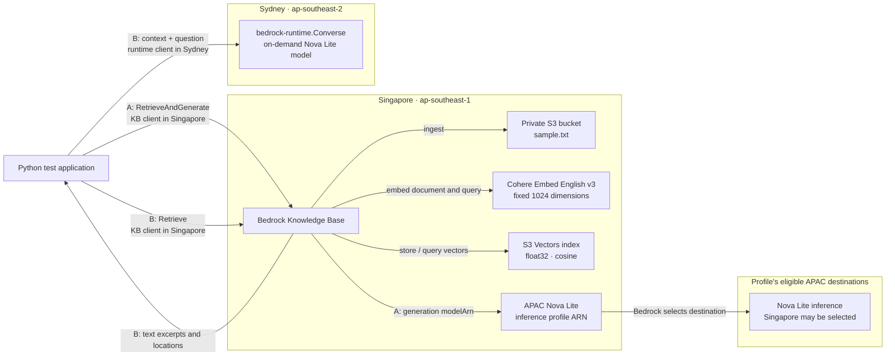
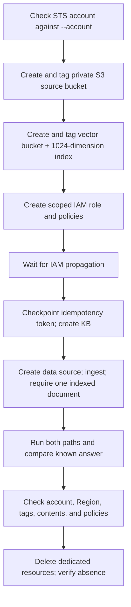

# Architecture

The KB, source document, embedding call, and vector index live in Singapore.
Generation takes one of two paths. Changing the generation model does not move
the embedding configuration or vector store.

**Path A: managed RAG.** The application calls Singapore
`bedrock-agent-runtime.RetrieveAndGenerate` and passes the Singapore
inference-profile ARN as `knowledgeBaseConfiguration.modelArn`. Bedrock retrieves
the context, selects a destination from the profile, generates an answer, and
returns native citation objects. `GetInferenceProfile.models` lists eligible
destinations; it does not reveal the destination used by a particular request.

**Path B: application-controlled RAG.** The application calls Singapore
`Retrieve`, numbers the returned text excerpts, then calls Sydney
`bedrock-runtime.Converse`. The question and retrieved text cross the Region
boundary. The model writes `[1]` source labels; these are not native KB citation
objects. A routing profile used as the remote model could send inference beyond
Sydney, so the demonstrated path uses a regional on-demand foundation model.

The optional third comparison sends a Sydney foundation-model ARN to Singapore
`RetrieveAndGenerate`. It records the actual response rather than assuming the
ARN will be rejected. The live test returned `ValidationException`.

## Provisioning and ownership

Resources receive a unique run ID. The manifest is written atomically after
resource creation and before the KB creation request. Its KB token is reused
for resumption. Cleanup operates only on recorded resources after ownership
checks. It does not remove unexpected source objects, role policies, or an index
with another run ID. API retries are disabled for the probe; KB role propagation
has a bounded retry during creation.

The KB service role can read the dedicated source prefix, invoke the regional
embedding model, and access the dedicated vector index. The application caller
has its own generation permissions. The role's trust policy initially permits
KBs from the expected account and Region, then narrows to the created KB ARN.

## Tradeoffs and limits

| Concern | Experiment choice and implication |
| --- | --- |
| Operations | Small local scripts and an atomic manifest; no scheduled jobs or pipelines |
| Security | Synthetic data, private source bucket, scoped role, account and ownership checks |
| Reliability | Bounded calls and checkpointed KB creation; failures require inspection rather than blind replay |
| Performance | One document and question establish interoperability, not throughput or tail latency |
| Cost | S3 Vectors avoids a provisioned search cluster; calls and storage still incur AWS charges |
| Sustainability | One tiny fixture and immediate removal of dedicated infrastructure |

This is a focused experiment, not a production RAG framework. Production use
needs prompt evaluation, data access controls, retry and timeout policies,
observability, and explicit processing-Region requirements.
